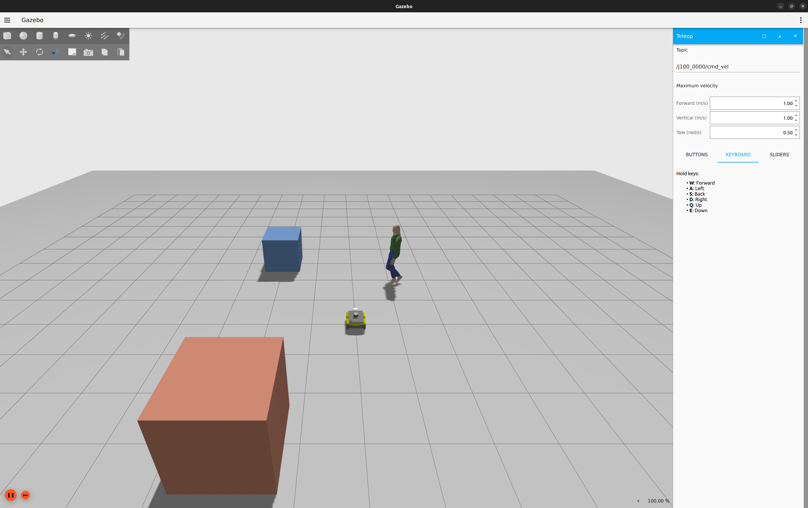
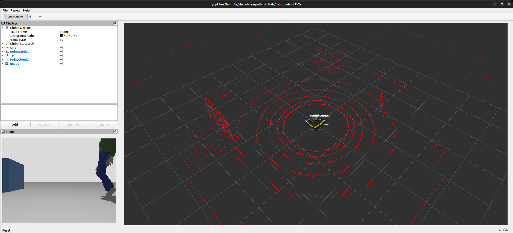

# Jackal Actor Simulation

<p align="center">
  
</p>

<p align="center">
  
</p>

ROS 2 Humble / Gazebo Fortress simulation containing:

- Clearpath Jackal J100
- Intel RealSense D435 RGB-D camera
- Velodyne VLP-16 3D LiDAR
- Scripted Gazebo human actor
- Custom Gazebo environment
- RViz visualization

## Tested Environment

- Ubuntu 22.04
- ROS 2 Humble
- Gazebo Fortress
- Clearpath Jackal J100

## Repository Structure

```text
jackal_actor_sim/
├── config/
│   └── robot.yaml
├── worlds/
│   └── jackal_actor_world.sdf
├── patches/
│   └── clearpath_spawn_world.patch
├── scripts/
│   ├── check_environment.sh
│   └── setup_workspace.sh
└── dependencies.repos
```

## Prerequisites

ROS 2 Humble and Gazebo Fortress must already be installed.

Install basic development tools:
```bash
sudo apt update

sudo apt install -y \
    git \
    python3-vcstool \
    python3-rosdep \
    python3-colcon-common-extensions
```
## Installation

Clone this repository:
```bash
cd ~

git clone https://github.com/putraaryawinata/jackal_actor_sim.git

cd jackal_actor_sim
```

Check the environment:
```bash
./scripts/check_environment.sh
```
Create and build the ROS workspace:
```bash
./scripts/setup_workspace.sh
```
Source it:
```bash
source /opt/ros/humble/setup.bash
source ~/jackal_actor_ws/install/setup.bash
```

## Run the simulation
Terminal 1 — Gazebo
```bash
source /opt/ros/humble/setup.bash
source ~/jackal_actor_ws/install/setup.bash

ros2 launch clearpath_gz simulation.launch.py \
    world:=jackal_actor_world \
    x:=0.0 \
    y:=0.0 \
    z:=0.3 \
    yaw:=0.0 \
    rviz:=false
```
Terminal 2 — RViz
```bash
source /opt/ros/humble/setup.bash
source ~/jackal_actor_ws/install/setup.bash

ros2 launch clearpath_viz view_robot.launch.py \
    namespace:=j100_0000 \
    use_sim_time:=true
```
## Sensor Topics

Check available sensor topics:
```bash
ros2 topic list | grep -E 'camera|lidar|points'
```
Expected topics include:
```text
/j100_0000/sensors/camera_0/color/image
/j100_0000/sensors/camera_0/depth/image
/j100_0000/sensors/camera_0/points
/j100_0000/sensors/lidar3d_0/points
```
Check the Velodyne:
```bash
ros2 topic hz /j100_0000/sensors/lidar3d_0/points
```
Check the RGB camera:
```bash
ros2 topic hz /j100_0000/sensors/camera_0/color/image
```

## Teleoperation
```bash
ros2 run teleop_twist_keyboard teleop_twist_keyboard \
    --ros-args \
    -r __ns:=/j100_0000
```

## Notes
Task 3-1 provides a standalone Python generator for straight, turning, and
circular human trajectories, with CSV export. It requires no ROS installation:

```bash
python3 scripts/generate_trajectory.py --scenario straight --output trajectories/straight.csv
```

See [the trajectory generator guide](docs/trajectory_generator.md) for Korean
instructions, coordinate and timestamp conventions, and examples.

Task 3-2 publishes those CSV targets over ROS 2 as `PoseStamped` messages:

```bash
source /opt/ros/humble/setup.bash
python3 scripts/trajectory_publisher.py --csv trajectories/straight.csv
```

See [the trajectory publisher guide](docs/trajectory_publisher.md) for topic
inspection, simulation time, and the interface for a future Gazebo controller.

Task 3-3 controls `walking_person` using a Fortress System Plugin. It accepts
`PoseStamped` commands for logical ID `human_1` and the existing `walking_person`
topic. See [the actor controller guide](docs/actor_controller.md) for the
workspace symlinks, build, execution order, mappings, and verification limits.
After updating this repository, build `jackal_actor_controller` and source the
workspace before launching the updated world.

Task 3-4 records independently observed actor poses and compares them with the
replayed target. Open the live Python UI to compare a CSV and Gazebo GT:

```bash
source /opt/ros/humble/setup.bash
source ~/jackal_actor_ws/install/setup.bash
python3 scripts/trajectory_viewer.py --csv trajectories/human_1_right_turn.csv
```

Click **Start trajectory** in the window. Measured GT points, linearly
interpolated paths, and errors update live. CSV recording is automatic; trajectory
PNG saving has been removed. See the [live comparison guide](docs/ground_truth_validation.md)
for the two-terminal workflow, interpolation rules, and output CSVs.

Task 3-5 adds mouse drawing, waypoint dragging/deletion, numeric editing,
Undo/Redo, speed/rate settings, and CSV export to the same Python UI:

```bash
python3 scripts/trajectory_viewer.py --start-delay 3
```

Click **Draw / edit path**, draw a route, then choose **Use path / preview**
or **Send to Gazebo**. The existing Publisher and Controller execute the path,
and actual GT is recorded and compared live. The default XY view matches the
Clearpath Gazebo camera (+X up, +Y left); the view selector/yaw control changes
only display orientation, while CSV and ROS messages stay in world coordinates.
See the [trajectory GUI guide](docs/trajectory_gui.md)
for setup, editing, time conversion, and validation limits.

This repository does not vendor the Clearpath ROS repositories. Exact
dependencies are recorded in dependencies.repos and imported using
vcstool.

The repository also applies a small patch to the ROS 2 Humble Clearpath
Gazebo spawn launch file so that the robot is explicitly spawned into the
requested Gazebo world.
